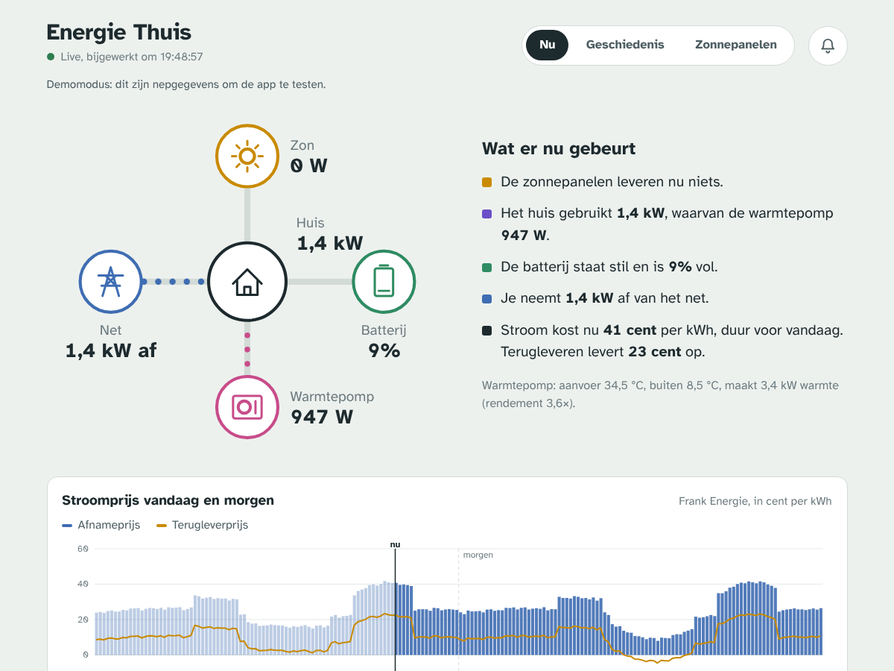
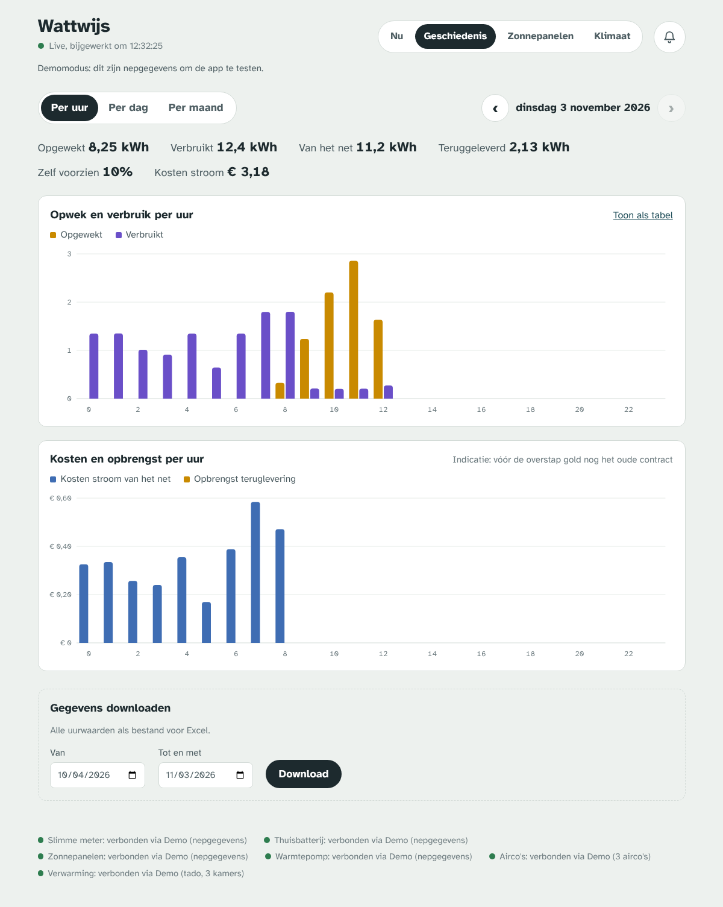
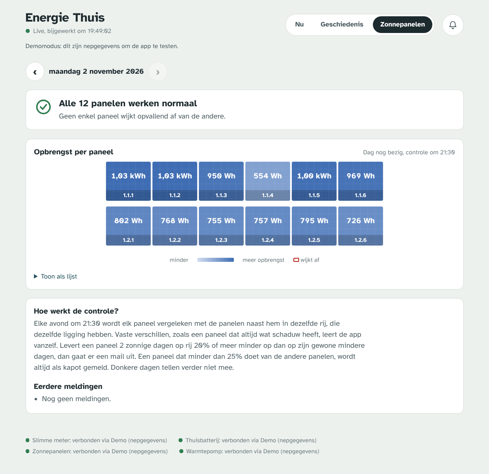

# Energiemonitor

*[Nederlandse versie](README.nl.md)*

A self-hosted web app that shows everything happening on a home's electricity connection in one place: solar production, house and heat pump consumption, the home battery charging or discharging, and import or export through the smart meter. It runs on a Raspberry Pi or home server and reads the devices on your local network wherever it can.

It was built for one Dutch household with a heat pump, a home battery, solar panels and a dynamic energy contract. Every device brand is a small plug-in, so adding your own hardware is one file.

| Now | History | Solar panels |
|---|---|---|
|  |  |  |

## Features

- **Live energy flow**, refreshed every 5 seconds: grid, solar, battery (state of charge and power), heat pump, and the computed house consumption.
- **Everything logged per minute** in SQLite. You can browse it per hour, day or month and download it as CSV.
- **Per-panel check for solar panels.** Every evening each panel is compared with its neighbours in the same row. When one keeps falling behind or dies, you get an email and a push notification. The app learns fixed shading by itself, so it doesn't send false alarms. The roof is drawn the way the SolarEdge portal draws it.
- **Dynamic prices** (15-minute resolution) with costs and revenue in euros, the cheapest 2-hour block of the day, and warnings for negative prices.
- **Installable web app with push notifications**, including on iPhone: a morning tip with the cheapest time to run the dishwasher, panel alerts, daily records and a weekly summary.
- **Read-only.** The app never changes a setting on any device.
- **Demo mode** with simulated data, so you can try it without any hardware.

The user interface is in Dutch. Translations are welcome (see [CONTRIBUTING.md](CONTRIBUTING.md)).

## Supported devices

Each *role* has one active integration. The app picks one automatically from the settings you fill in, or you choose it with `<ROLE>_INTEGRATION=<key>` in `.env`. `GET /api/integrations` lists what is available and what is selected.

| Role | Key | Device | How |
|---|---|---|---|
| `grid` | `smeter` | SMeter-RS06 P1 dongle (AECC) | Local JSON on `http://<ip>/` |
| `grid` | `homewizard` | HomeWizard P1 meter | Local API v1 |
| `battery` | `aecc` | Batteries on the AECC platform: Voltdeer, Sunpura, Lunergy, AEG, … | Local TCP port 8080 |
| `solar` | `solaredge_modbus` | SolarEdge inverter | Local Modbus TCP, port 1502 |
| `solar` | `solaredge_cloud` | SolarEdge inverter | Monitoring portal, every 2 minutes |
| `panels` | `solaredge` | SolarEdge optimizers (per-panel yield) | Monitoring portal |
| `heatpump` | `dewarmte` | DeWarmte (Pomp AO, MP, T, Heatcycle) | mydewarmte.com cloud API |
| `prices` | `frank` | Frank Energie (NL) | Public GraphQL API, no login |
| all | `demo` | Simulated household | — |

Every role is optional. Without a battery, the app works without one. Without a grid meter, it uses the meter value the battery reports, if it has one.

## Quick start

You need Docker with Compose.

```bash
git clone https://github.com/<you>/energiemonitor.git
cd energiemonitor
cp .env.example .env        # DEMO=1 by default
mkdir data
docker compose up -d --build
```

Open `http://<server-ip>:8000`. You'll see a simulated home. When that works, set `DEMO=0` in `.env`, fill in your devices (see below) and run `docker compose up -d` again. Check the log with `docker compose logs -f`. The footer of the app shows each source, which integration it uses, and its last error.

### Where to run it

The app has to reach the battery, the P1 dongle and (optionally) the inverter **on the local network**. You can run it:

- on a Raspberry Pi or server in the house itself. A Pi 3 or 4 is plenty, and the database grows by roughly 50 MB per year;
- on a server somewhere else that reaches the home network, for example through a Tailscale subnet router, or a small TCP forward (`socat`) on a device in the house.

## Device setup

**P1 smart meter** (`P1_HOST`, `P1_TYPE`)

1. Give the dongle a fixed DHCP reservation and fill in its IP as `P1_HOST`.
2. Whether the SMeter reports export as negative power isn't documented. The app therefore also infers the direction from which meter counter is rising, and the sign is right after the first few readings. If import and export still look swapped, set `GRID_INVERT=1`.
3. For a HomeWizard P1 meter, set `P1_TYPE=homewizard` and turn on *Local API* in the HomeWizard app.

**Home battery** (`BATTERY_HOST`)

1. Give the battery a fixed IP and check that port 8080 is open: `nc -vz <ip> 8080`.
2. The battery accepts **one** local connection at a time. If the Home Assistant `aecc_battery` integration also talks to it, turn one of them off.

**SolarEdge**

1. `SOLAREDGE_USERNAME`, `SOLAREDGE_PASSWORD` and `SOLAREDGE_SITE_ID` are your monitoring.solaredge.com login. The site ID is the number in the portal's address bar.
2. Per-panel data needs access to the **Layout** tab in the portal. If you can't see your panels there, ask your installer to enable it.
3. Recommended: have Modbus TCP enabled on the inverter (SetApp → Communication → LAN → Modbus TCP, port 1502; usually done by the installer) and fill in `SOLAREDGE_MODBUS_HOST`. Live production then updates every 5 seconds instead of every 2 minutes.

**DeWarmte**: the same email and password as on mydewarmte.com.

**Email**: any SMTP server works. For Gmail, use an *app password*. Send a test with:

```bash
docker compose exec energiemonitor python -m app.testmail
```

`ALERT_TO` receives panel and price alerts. `ADMIN_TO` receives technical alerts, such as a device that hasn't reported for 2 hours.

## How the panel check works

Panels on one roof naturally differ: one row gets more shade than another, and which row does best changes with the weather and the position of the sun. A fair comparison is only possible with the panels **right next to** each other. So you describe the physical layout as it appears in the SolarEdge portal: rows separated by `;`, panels from left to right separated by `,`.

```
PANEL_LAYOUT=1.1.1,1.1.2,1.1.3,1.1.4;1.1.8,1.1.7,1.1.6,1.1.5
```

During the day the tiles are refreshed every `PANEL_REFRESH_MINUTES` (15), and right away when you open the tab. Every evening at `PANEL_CHECK_TIME`:

- **Share** = the panel's yield divided by the median of the other panels in its row. A dead panel never counts as the reference for its neighbours.
- **Normal** = the panel's share over the last `PANEL_BASELINE_DAYS` (30) usable days. The lower bound is the 20th percentile, which covers the worse ordinary days. This way, permanent shade on one panel doesn't trigger an alert. At least 5 days of history are needed.
- **Low** = `PANEL_THRESHOLD_PERCENT` (20%) or more below that lower bound.
- **Dead** = less than `PANEL_DEAD_SHARE` (0.25) of the other panels. This rule always applies, also on dark days and without a layout.
- Without `PANEL_LAYOUT`, only the *dead* rule is used, because comparing across rows gives too many false alarms.
- An alert goes out only after `PANEL_CONSECUTIVE_DAYS` (2) usable days in a row, followed by a "back to normal" message once the panel recovers. While an alert is open, that panel's baseline is frozen.
- At startup the app fetches the last 14 days and re-evaluates open alerts. Alerts that the current rules or layout no longer support are withdrawn without a mail.

## Prices and costs

- Quarter-hour prices are fetched for today and, from about 13:00, for tomorrow. They are refreshed every 3 hours.
- **Costs** are calculated per minute: import × the all-in price of that quarter, and export × the feed-in price. The feed-in price is `market price × EXPORT_MULTIPLIER + EXPORT_FEE_EUR`. Take the fee from your contract.
- **Battery value** is an estimate: discharged energy at the import price, minus charging at either the import price (from the grid) or the feed-in price (from solar surplus). It is meaningful over a month, not over a single day.
- The amounts are variable costs only. Fixed delivery costs, grid fees and the yearly energy tax reduction are not included.
- Amounts before `CONTRACT_START` are shown as an indication.
- To compare the prices component by component with your supplier's app, run `docker compose exec energiemonitor python -m app.checkprices [YYYY-MM-DD]`.

## Home screen app and push notifications

The app is a Progressive Web App: it has its own icon, runs without browser bars and can send push notifications. You don't need an App Store app.

Push needs **HTTPS**. The easiest way is `tailscale serve --bg --https=8443 http://localhost:8000`, or any reverse proxy with a certificate.

**On an iPhone** (iOS 16.4 or newer):

1. Open the HTTPS address in **Safari**.
2. Tap **•••** → **Share** (iOS 26; on older versions tap the share button directly), then **Add to Home Screen**. Leave **Open as Web App** on.
3. Open the app from the new icon, tap the **bell** in the top right and choose to turn on notifications. You'll get a test notification right away.
4. Choose per type which notifications you want. This is stored per device.

| Type | When |
|---|---|
| Morning tip | `PUSH_MORNING_TIME`: the cheapest `PUSH_BLOCK_HOURS`-hour block within `PUSH_BLOCK_WINDOW`, the most expensive moment, negative prices, yesterday in short, and a panel that is still broken |
| Solar panel | right after the evening check, when a panel breaks or recovers |
| Negative price | around 13:00, when tomorrow has negative prices |
| Records | `PUSH_EVENING_TIME`: a production record, a day that was at least 95% self-sufficient, or every 500 kWh produced |
| Weekly summary | Sunday at `PUSH_WEEKLY_TIME` |
| Technical | a device has been silent for `OFFLINE_ALERT_MINUTES` (off by default) |

The push keys are created on first start in `data/vapid_private.pem`. If you delete `data/`, every phone has to turn notifications on again. Set `PUSH_CONTACT` (or `ADMIN_TO`) to a real email address, because the push services require a contact address.

## Remote access

Always set `BASIC_AUTH_USER` and `BASIC_AUTH_PASS`, or put the app behind Tailscale, Cloudflare Access or a reverse proxy with authentication. The app is a single port (8000).

## Data

- SQLite in `data/energie.sqlite`. Demo mode uses its own file, `energie-demo.sqlite`, so demo and real data never mix.
- Main tables: `minute` (Wh and average W per minute), `panel_day` (Wh per panel per day), `panel_alert` and `price`.
- Hourly CSV: on the History tab, or directly at `/api/export.csv?start=2027-01-01&end=2027-01-31`.
- House consumption is computed as `grid + solar + battery output`, where battery output is negative while charging. The heat pump is part of the house consumption.

## Development

```bash
python -m venv .venv && . .venv/bin/activate
pip install -r requirements.txt pytest
DEMO=1 DATA_DIR=./data uvicorn app.main:app --reload
pytest
```

The code is a FastAPI back end (`app/`) with a plain HTML, CSS and JavaScript front end (`app/static/`): no build step and no framework. Device integrations live in `app/integrations/`. To add a brand, see [CONTRIBUTING.md](CONTRIBUTING.md) and `app/integrations/_template.py`.

## Caveats

- The battery, DeWarmte and SolarEdge portal integrations use **unofficial** interfaces, the same ones the Home Assistant community integrations use. A firmware or portal update can break them. The app keeps running and shows the error in the footer.
- The Frank Energie price API is public but not officially documented.
- This is a hobby project and is not affiliated with any of the brands mentioned.

## Acknowledgements

The device protocols were figured out by others first. Thanks to:

- [StekkerDeal/aecc-battery-local](https://github.com/StekkerDeal/aecc-battery-local) for the AECC battery protocol
- [ronald-willems/dewarmte-homeassistant](https://github.com/ronald-willems/dewarmte-homeassistant) for the DeWarmte API
- [solaredge-web](https://pypi.org/project/solaredge-web/) and [solaredged](https://pypi.org/project/solaredged/) for SolarEdge
- [python-frank-energie](https://github.com/HiDiHo01/python-frank-energie) for the Frank Energie query

The interface uses [Atkinson Hyperlegible](https://www.brailleinstitute.org/freefont/) by the Braille Institute, under the SIL Open Font License.

## License

[MIT](LICENSE)
