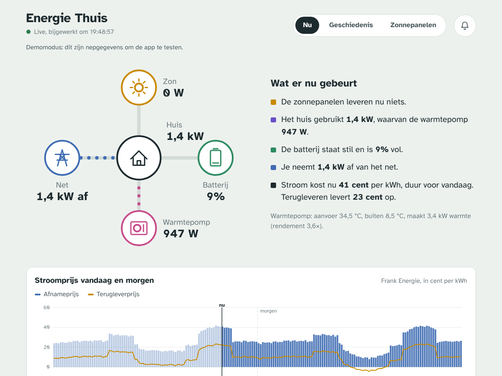
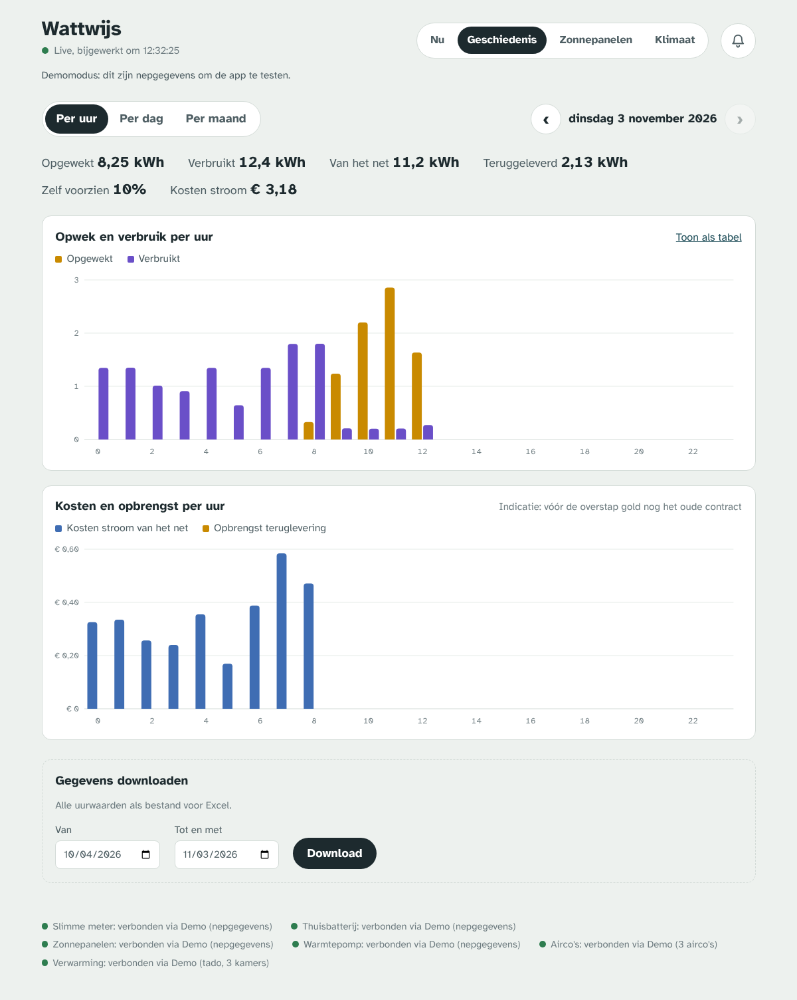
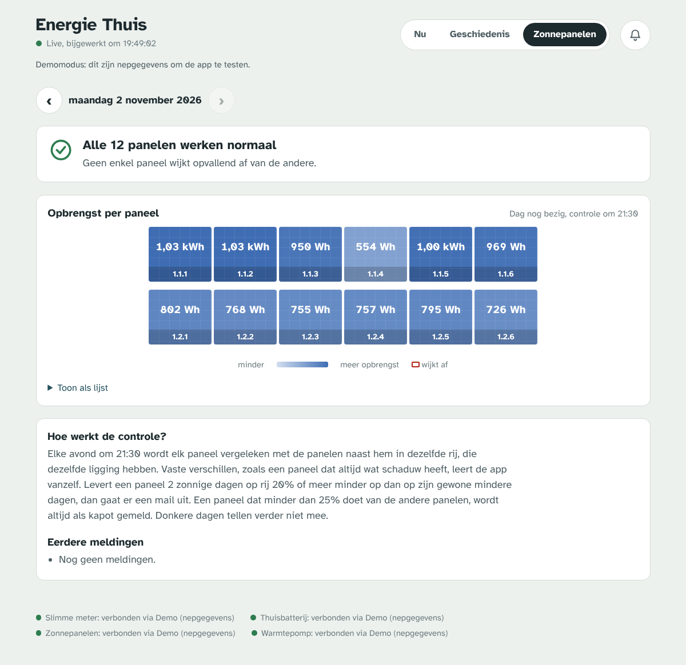

# Energiemonitor

*[English version](README.md)*

Een webapp om zelf te hosten, die op één plek laat zien wat er op de stroomaansluiting thuis gebeurt: opwek van de zonnepanelen, verbruik van het huis en de warmtepomp, laden en ontladen van de thuisbatterij, en afname en teruglevering via de slimme meter. De app draait op een Raspberry Pi of thuisserver en leest de apparaten waar mogelijk lokaal uit.

Hij is gemaakt voor een Nederlands huishouden met een warmtepomp, een thuisbatterij, zonnepanelen en een dynamisch energiecontract. Elk merk is een kleine plug-in, dus je eigen apparaat toevoegen is één bestand.

| Nu | Geschiedenis | Zonnepanelen |
|---|---|---|
|  |  |  |

## Wat kan het?

- **Live overzicht**, elke 5 seconden ververst: net, zon, batterij (laadniveau en vermogen), warmtepomp en het berekende huisverbruik.
- **Alles wordt per minuut opgeslagen** in SQLite. Je kunt het per uur, dag of maand terugkijken en als CSV downloaden.
- **Controle per zonnepaneel.** Elke avond wordt elk paneel vergeleken met de panelen naast hem in dezelfde rij. Blijft er een achter of valt er een uit, dan krijg je een mail en een pushmelding. Vaste schaduw leert de app vanzelf, dus die geeft geen valse meldingen. Het dak wordt getekend zoals in het SolarEdge-portaal.
- **Dynamische prijzen** per kwartier, met kosten en opbrengst in euro's, het goedkoopste blok van 2 uur en waarschuwingen voor negatieve prijzen.
- **Installeerbare webapp met pushmeldingen**, ook op de iPhone: een ochtendtip met het goedkoopste moment voor de vaatwasser, paneelmeldingen, records en een weekoverzicht.
- **Tabblad Klimaat**: de temperatuur per kamer instellen op tado° X, en airco's aan- en uitzetten met stand, temperatuur, luchtstroom en ventilator. Het verbruik van de airco's wordt per unit geschat.
- **Standaard alleen lezen.** De app verandert nooit een instelling op een apparaat, behalve de airco's en de tado-verwarming als iemand het tabblad Klimaat gebruikt (de airco's zet je op alleen lezen met `AIRCO_CONTROL=0`).
- **Demomodus** met nepgegevens, om het zonder apparaten te proberen.

## Ondersteunde apparaten

Per *rol* is er één koppeling actief. De app kiest die automatisch op basis van de instellingen die je invult. Je kunt hem ook zelf kiezen met `<ROL>_INTEGRATION=<sleutel>` in `.env`. Via `GET /api/integrations` zie je wat er beschikbaar en gekozen is.

| Rol | Sleutel | Apparaat | Hoe |
|---|---|---|---|
| `grid` | `smeter` | SMeter-RS06 P1-dongle (AECC) | Lokale JSON op `http://<ip>/` |
| `grid` | `homewizard` | HomeWizard P1-meter | Lokale API v1 |
| `battery` | `aecc` | Batterijen op het AECC-platform: Voltdeer, Sunpura, Lunergy, AEG, … | Lokaal via TCP-poort 8080 |
| `solar` | `solaredge_modbus` | SolarEdge-omvormer | Lokaal via Modbus TCP, poort 1502 |
| `solar` | `solaredge_cloud` | SolarEdge-omvormer | Monitoringportaal, elke 2 minuten |
| `panels` | `solaredge` | SolarEdge-optimizers (per paneel) | Monitoringportaal |
| `heatpump` | `dewarmte` | DeWarmte (Pomp AO, MP, T, Heatcycle) | Cloud-API van mydewarmte.com |
| `aircon` | `wfrac` | Mitsubishi Heavy Industries met wifi-module WF-RAC (Smart M-Air-app) | Lokale API, poort 51443 |
| `heating` | `tado` | tado° X (Thread/Matter-lijn) | Cloud-API van tado, koppelen in de app |
| `prices` | `frank` | Frank Energie | Openbare API, geen login |
| alle | `demo` | Gesimuleerd huishouden | — |

Elke rol is optioneel. Zonder batterij werkt de app gewoon zonder batterij. Zonder P1-meter gebruikt hij de meterwaarde van de batterij, als die er een heeft.

## Snel starten

Je hebt Docker met Compose nodig.

```bash
git clone https://github.com/<jij>/energiemonitor.git
cd energiemonitor
cp .env.example .env        # staat standaard op DEMO=1
mkdir data
docker compose up -d --build
```

Open `http://<ip-van-de-server>:8000`. Je ziet nu een nephuis. Werkt dat, zet dan `DEMO=0` in `.env`, vul je apparaten in (zie hieronder) en start opnieuw met `docker compose up -d`. Met `docker compose logs -f` zie je wat er gebeurt. Onderaan de app staat per bron welke koppeling hij gebruikt en wat de laatste foutmelding was.

### Waar draaien?

De app moet de batterij, de P1-dongle en eventueel de omvormer **op het lokale netwerk** kunnen bereiken. Dat kan:

- op een Raspberry Pi of server in het huis zelf. Een Pi 3 of 4 is ruim voldoende, en de database groeit ongeveer 50 MB per jaar;
- op een server elders die bij het thuisnetwerk kan, bijvoorbeeld via een Tailscale-subnetroute of een kleine TCP-doorverwijzing (`socat`) op een apparaat in huis.

## Apparaten instellen

**Slimme meter (P1)** (`P1_HOST`, `P1_TYPE`)

1. Geef de dongle een vaste IP-reservering in de router en vul het IP-adres in als `P1_HOST`.
2. Of de SMeter teruglevering als negatief vermogen doorgeeft, is niet gedocumenteerd. De app bepaalt de richting daarom ook uit welke meterstand oploopt, en na de eerste paar metingen klopt het teken. Zijn afname en teruglevering toch omgewisseld, zet dan `GRID_INVERT=1`.
3. Voor een HomeWizard P1-meter: `P1_TYPE=homewizard` en zet *Lokale API* aan in de HomeWizard-app.

**Thuisbatterij** (`BATTERY_HOST`)

1. Geef de batterij een vast IP-adres en controleer dat poort 8080 open staat: `nc -vz <ip> 8080`.
2. De batterij accepteert maar **één** lokale verbinding tegelijk. Praat de Home Assistant-integratie `aecc_battery` er ook mee, zet er dan één uit.

**SolarEdge**

1. `SOLAREDGE_USERNAME`, `SOLAREDGE_PASSWORD` en `SOLAREDGE_SITE_ID` zijn je gegevens van monitoring.solaredge.com. Het site-ID is het getal in de adresbalk van het portaal.
2. Voor de opbrengst per paneel heb je toegang nodig tot het tabblad **Indeling (Layout)** in het portaal. Zie je je panelen daar niet, vraag de installateur dan om die toegang aan te zetten.
3. Aanbevolen: laat Modbus TCP aanzetten op de omvormer (SetApp → Communicatie → LAN → Modbus TCP, poort 1502; meestal doet de installateur dit) en vul `SOLAREDGE_MODBUS_HOST` in. De live opwek ververst dan elke 5 seconden in plaats van elke 2 minuten.

**DeWarmte**: hetzelfde e-mailadres en wachtwoord als op mydewarmte.com.

**Airco's** (`AIRCO_UNITS`)

1. Elke binnenunit heeft de wifi-module WF-RAC nodig en moet al werken in de Smart M-Air-app.
2. Geef elke binnenunit een vast IP-adres en zet ze in `AIRCO_UNITS=Woonkamer=192.168.1.40;Slaapkamer=192.168.1.41`. Bij een multisplit is dat één regel per binnenunit.
3. Bij het eerste contact meldt de app zich op elke unit aan als extra gebruiker, net als een tweede telefoon. Meldt de unit dat er geen plek meer is, verwijder dan een oude koppeling in de Smart M-Air-app.
4. De units geven geen vermogen in watt door. De app schat het per unit uit of de compressor draait en uit de energieteller van de unit, die telt in stappen van 0,25 kWh. Zie het als een indicatie; voor exacte cijfers zet je een kWh-meter op de airco-groep.
5. De wifi-module kent geen ECO-stand; ECO van de afstandsbediening gaat waarschijnlijk uit na een opdracht uit de app.
6. Na een opdracht houdt de unit de app 60 seconden vast, dus de Smart M-Air-app kan die unit dan een minuut niet bedienen. Wil je alleen uitlezen, zet dan `AIRCO_CONTROL=0`.

**tado° X** (`TADO_ENABLED=1`)

1. Open het tabblad Klimaat, tik op **Koppel tado**, open de link en log in met het tado-account. De app bewaart een token in `data/tado_token.json`; er komt geen wachtwoord in `.env`.
2. tado staat zonder Auto-Assist-abonnement **100 aanvragen per dag** toe. De app leest de kamers daarom elke `TADO_POLL_MINUTES` (20) minuten uit en past na een opdracht de kaart zelf aan, zonder alles opnieuw op te halen. Met Auto-Assist (20.000 per dag) kun je vaker laten uitlezen.
3. Een temperatuur uit de app geldt tot het volgende blok in het schema (`TADO_MANUAL_UNTIL=next_block`) of tot je de kamer terugzet op schema (`manual`).
4. **Opwarmen** zet de kamer op `TADO_COMFORT_TEMP` (21 °C) voor `TADO_COMFORT_HOURS` (3) uur en gaat daarna terug naar het schema. Dezelfde actie bestaat als `POST /api/heating/comfort`, zodat een iPhone-opdracht ("Hé Siri, ik kom naar huis") hem kan starten: voeg in Opdrachten de actie *Haal inhoud van URL op* toe met methode POST naar `https://<jouw-app>/api/heating/comfort`, en een header `Authorization` als je basic auth gebruikt.
5. Alleen de tado X-lijn wordt nu ondersteund; oudere V3+-installaties gebruiken een andere API.

**Mail**: elke SMTP-server werkt. Voor Gmail gebruik je een *app-wachtwoord*. Testen:

```bash
docker compose exec energiemonitor python -m app.testmail
```

`ALERT_TO` krijgt de paneel- en prijsmeldingen. `ADMIN_TO` krijgt technische meldingen, zoals een apparaat dat al 2 uur niets doorgeeft.

## Zo werkt de paneelcontrole

Panelen op één dak verschillen van nature: de ene rij krijgt meer schaduw dan de andere, en welke rij het best presteert verschilt met het weer en de stand van de zon. Eerlijk vergelijken kan daarom alleen met de panelen **die ernaast liggen**. Geef daarvoor de fysieke indeling op zoals in het SolarEdge-portaal: rijen gescheiden door `;`, panelen van links naar rechts gescheiden door `,`.

```
PANEL_LAYOUT=1.1.1,1.1.2,1.1.3,1.1.4;1.1.8,1.1.7,1.1.6,1.1.5
```

Overdag worden de tegels elke `PANEL_REFRESH_MINUTES` (15) minuten ververst, en meteen als je het tabblad opent. Elke avond om `PANEL_CHECK_TIME`:

- **Aandeel** = de opbrengst van het paneel gedeeld door de mediaan van de andere panelen in dezelfde rij. Een kapot paneel telt nooit mee als maatstaf voor zijn buren.
- **Normaal** = het aandeel van het paneel over de afgelopen `PANEL_BASELINE_DAYS` (30) meetbare dagen. De ondergrens is het 20e percentiel, dus de slechtere gewone dagen. Zo geeft vaste schaduw op één paneel geen melding. Hiervoor zijn minstens 5 dagen nodig.
- **Te laag** = `PANEL_THRESHOLD_PERCENT` (20%) of meer onder die ondergrens.
- **Kapot** = minder dan `PANEL_DEAD_SHARE` (0,25) van de andere panelen. Deze regel geldt altijd, ook op donkere dagen en zonder indeling.
- Zonder `PANEL_LAYOUT` geldt alleen de regel *kapot*, omdat vergelijken over rijen heen te veel valse meldingen geeft.
- Pas na `PANEL_CONSECUTIVE_DAYS` (2) meetbare dagen op rij gaat er een melding uit, en als het paneel herstelt volgt een "werkt weer normaal"-bericht. Zolang een melding open staat, wordt het normaal van dat paneel bevroren.
- Bij het opstarten haalt de app de afgelopen 14 dagen op en beoordeelt hij open meldingen opnieuw. Meldingen die volgens de huidige regels of indeling niet kloppen, worden zonder mail ingetrokken.

## Stroomprijzen en kosten

- De kwartierprijzen worden opgehaald voor vandaag en, vanaf ongeveer 13:00, voor morgen. Elke 3 uur worden ze ververst.
- **Kosten** worden per minuut berekend: afname × de all-in prijs van dat kwartier, en teruglevering × de terugleverprijs. De terugleverprijs is `marktprijs × EXPORT_MULTIPLIER + EXPORT_FEE_EUR`. De vergoeding staat in je contract.
- **Batterij leverde op** is een schatting: ontladen stroom tegen de afnameprijs, min het laden tegen de afnameprijs (uit het net) of de terugleverprijs (uit zonne-overschot). Kijk naar dit getal over een maand, niet over één dag.
- De bedragen zijn alleen variabele kosten. Vaste leveringskosten, netbeheerkosten en de jaarlijkse vermindering energiebelasting zitten er niet in.
- Bedragen vóór `CONTRACT_START` zijn een indicatie.
- Wil je de prijzen per onderdeel vergelijken met de app van je leverancier, gebruik dan `docker compose exec energiemonitor python -m app.checkprices [JJJJ-MM-DD]`.

## App op het beginscherm en pushmeldingen

De app is een installeerbare webapp: een eigen icoon, geen browserbalken en pushmeldingen. Een App Store-app is niet nodig.

Pushmeldingen hebben **https** nodig. Het makkelijkst is `tailscale serve --bg --https=8443 http://localhost:8000`, of een reverse proxy met een certificaat.

**Op een iPhone** (iOS 16.4 of nieuwer):

1. Open het https-adres in **Safari**.
2. Tik op **•••** → **Deel** (iOS 26; op oudere versies direct op de deelknop) en kies **Zet op beginscherm**. Laat **Open als webapp** aan staan.
3. Open de app via het nieuwe icoon, tik rechtsboven op het **belletje** en zet de meldingen aan. Je krijgt meteen een testmelding.
4. Kies per soort welke meldingen je wilt. Dat wordt per apparaat bewaard.

| Soort | Wanneer |
|---|---|
| Ochtendtip | `PUSH_MORNING_TIME`: het goedkoopste blok van `PUSH_BLOCK_HOURS` uur binnen `PUSH_BLOCK_WINDOW`, het duurste moment, negatieve prijzen, gisteren in het kort, en een paneel dat nog stuk is |
| Zonnepaneel | direct na de avondcontrole, als een paneel kapot gaat of weer werkt |
| Negatieve prijs | rond 13:00, als morgen de prijs negatief wordt |
| Teruglevering | vanaf `CONTRACT_START`: het huis levert al `PUSH_EXPORT_MINUTES` minuten meer dan `PUSH_EXPORT_W` terug (en de batterij is vol). In het stookseizoen met de tip om de verwarming een graad hoger te zetten, en een herinnering om `PUSH_HEAT_BACK_TIME` |
| Records | `PUSH_EVENING_TIME`: een opwekrecord, een dag die voor minstens 95% zelfvoorzienend was, of elke 500 kWh opgewekt |
| Weekoverzicht | zondag om `PUSH_WEEKLY_TIME` |
| Technisch | een apparaat geeft al `OFFLINE_ALERT_MINUTES` minuten niets door (staat standaard uit) |

De sleutels voor de pushmeldingen worden bij de eerste start gemaakt in `data/vapid_private.pem`. Gooi je `data/` weg, dan moet elke telefoon de meldingen opnieuw aanzetten. Vul `PUSH_CONTACT` (of `ADMIN_TO`) in met een echt e-mailadres, want de pushdiensten vragen een contactadres.

## Buiten het thuisnetwerk

Zet altijd `BASIC_AUTH_USER` en `BASIC_AUTH_PASS`, of zet de app achter Tailscale, Cloudflare Access of een reverse proxy met inlog. De app gebruikt één poort (8000).

## Gegevens

- SQLite in `data/energie.sqlite`. De demomodus gebruikt een eigen bestand, `energie-demo.sqlite`, zodat demo en echt nooit mengen.
- De belangrijkste tabellen: `minute` (Wh en gemiddeld vermogen per minuut), `panel_day` (Wh per paneel per dag), `panel_alert` en `price`.
- CSV met uurwaarden: op het tabblad Geschiedenis, of direct via `/api/export.csv?start=2027-01-01&end=2027-01-31`.
- Het huisverbruik wordt berekend als `net + zon + batterij-uitvoer`; de batterij-uitvoer is negatief tijdens het laden. De warmtepomp is een deel van het huisverbruik.

## Ontwikkelen

```bash
python -m venv .venv && . .venv/bin/activate
pip install -r requirements.txt pytest
DEMO=1 DATA_DIR=./data uvicorn app.main:app --reload
pytest
```

De back-end is FastAPI (`app/`), de voorkant gewone HTML, CSS en JavaScript (`app/static/`), zonder buildstap of framework. De koppelingen staan in `app/integrations/`. Wil je een merk toevoegen, kijk dan in [CONTRIBUTING.md](CONTRIBUTING.md) en `app/integrations/_template.py`.

## Kanttekeningen

- De koppelingen met de batterij, DeWarmte, de airco's en het SolarEdge-portaal gebruiken **onofficiële** interfaces, dezelfde als de Home Assistant-integraties uit de community. Na een firmware- of portaalupdate kan er iets breken. De app blijft dan draaien en toont de fout onderaan.
- De prijs-API van Frank Energie is openbaar, maar niet officieel gedocumenteerd.
- Dit is een hobbyproject, niet verbonden aan een van de genoemde merken.

## Met dank aan

De protocollen zijn eerst door anderen uitgezocht:

- [StekkerDeal/aecc-battery-local](https://github.com/StekkerDeal/aecc-battery-local) voor het AECC-batterijprotocol
- [ronald-willems/dewarmte-homeassistant](https://github.com/ronald-willems/dewarmte-homeassistant) voor de DeWarmte-API
- [solaredge-web](https://pypi.org/project/solaredge-web/) en [solaredged](https://pypi.org/project/solaredged/) voor SolarEdge
- [python-frank-energie](https://github.com/HiDiHo01/python-frank-energie) voor de query van Frank Energie
- [pywfrac](https://pypi.org/project/pywfrac/) en [blues-sechseck/Mitsubishi-WF-RAC-Integration](https://github.com/blues-sechseck/Mitsubishi-WF-RAC-Integration) voor het protocol van de Mitsubishi Heavy-airco's

Het lettertype is [Atkinson Hyperlegible](https://www.brailleinstitute.org/freefont/) van het Braille Institute, onder de SIL Open Font License.

## Licentie

[MIT](LICENSE)
